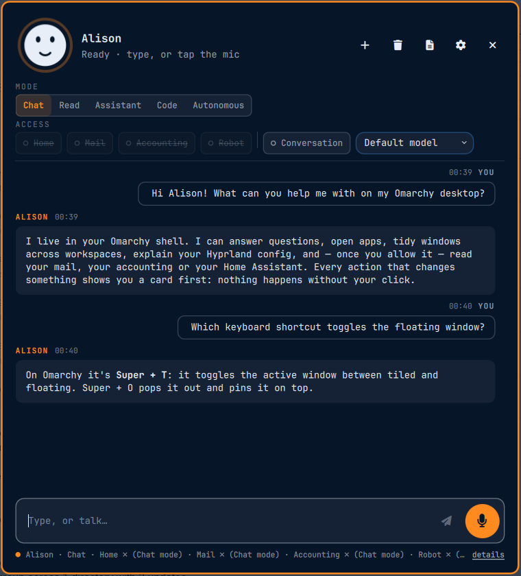
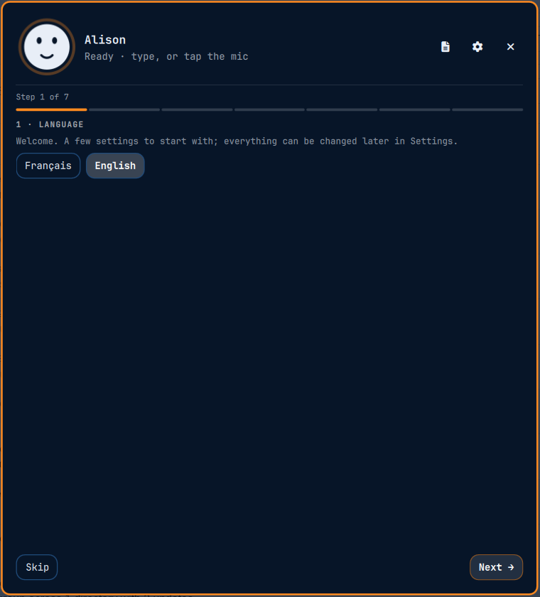
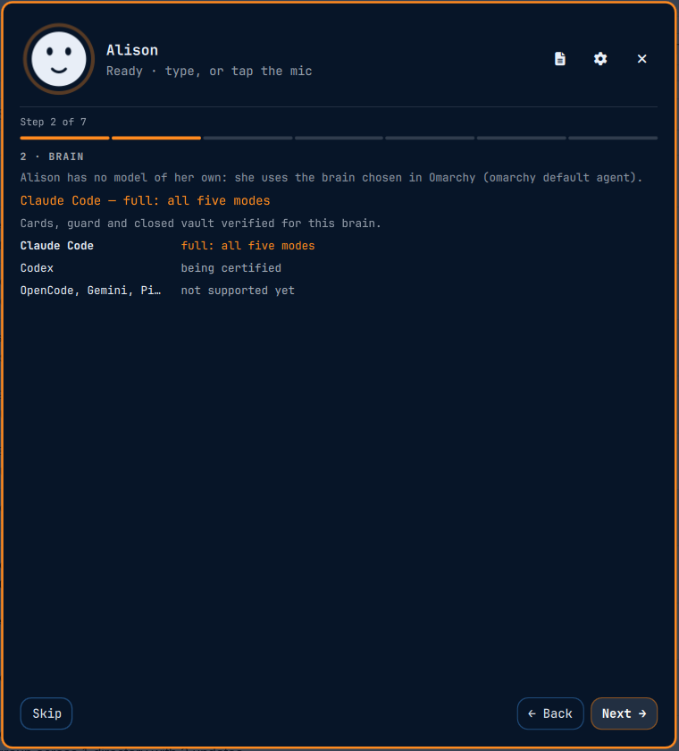
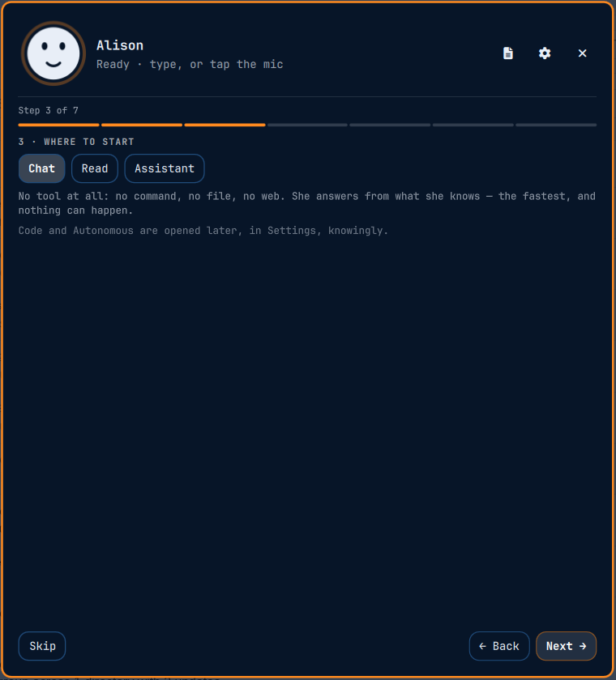
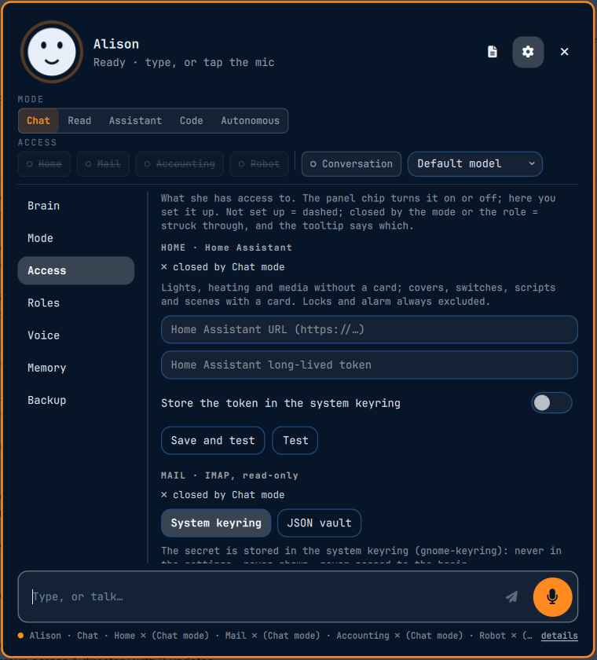
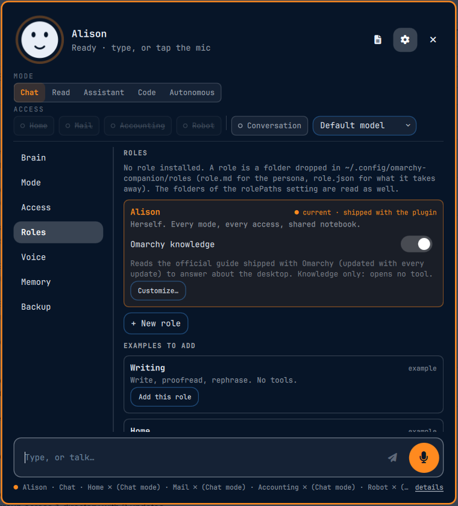
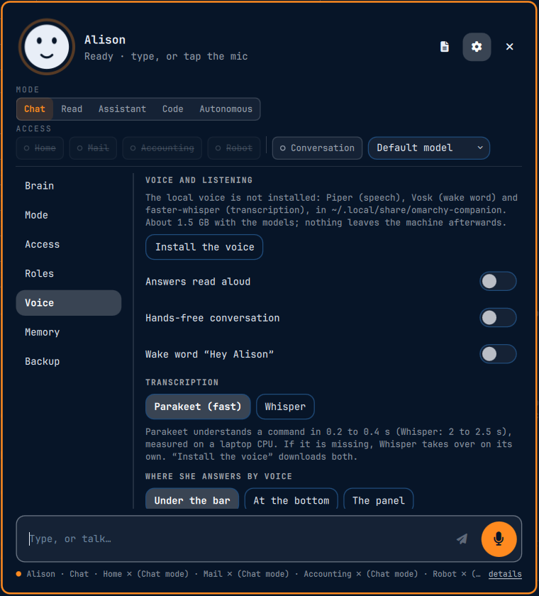
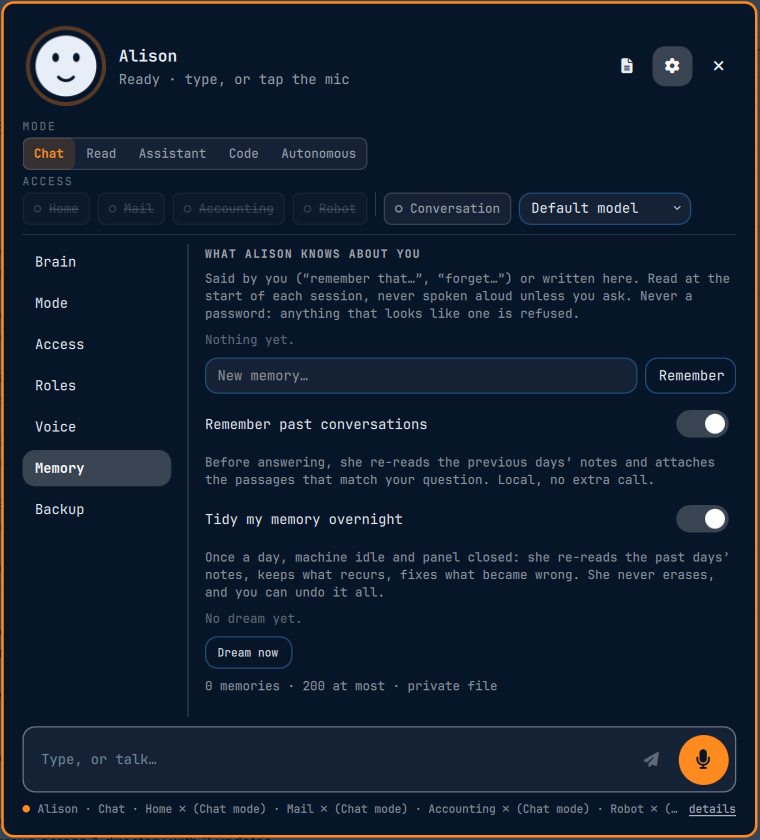
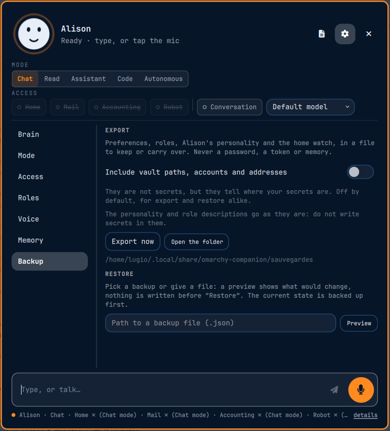

<!-- markdownlint-disable MD033 MD041 -->
<p align="center">
  
</p>

<h1 align="center">Alison</h1>

<p align="center">
  <strong>A desktop companion for Omarchy.</strong><br/>
  She lives in your shell, answers by text or voice, and asks before she touches anything.
</p>

<p align="center">
  <a href="CHANGELOG.md"></a>
  <a href="LICENSE"></a>
  <a href="https://omarchy.org"></a>
  
  
  
</p>

<p align="center">
  <a href="#quick-start">Quick start</a> ·
  <a href="#features">Features</a> ·
  <a href="#expressions">Expressions</a> ·
  <a href="#safety">Safety</a> ·
  <a href="#screenshots">Screenshots</a> ·
  <a href="docs/">Documentation</a>
</p>

<p align="center">
  
</p>

---

## ✨ Overview

Alison is an [Omarchy 4](https://omarchy.org) shell plugin: a panel, a bar widget and a background
service. She has **no model of her own** — she uses the agent you selected in Omarchy
(`omarchy default agent`) and wraps it in a permission guard, a local voice and a memory that tidies
itself.

- **Every change goes through a card.** Alison shows what she is about to do; nothing happens until you click.
- **Five permission modes**, from *Chat* (no tools at all) to *Autonomous* (logged, chosen by click only).
- **Local voice** — speech, wake word and transcription run on your machine, installed only on request.
- **Private by design** — memory and logs stay in your home folder, secrets in your keyring or vault.
- **English and French** interfaces, picked in the first-run wizard.

<a id="quick-start"></a>

## 🚀 Quick start

**Requirements:** Omarchy 4 and [Claude Code](https://claude.com/claude-code) available as `claude`,
selected with `omarchy default agent claude` (it currently provides the complete permission guard).

```bash
omarchy plugin add https://github.com/lugio/oma-companion --enable
```

Open the panel from the bar widget: a **seven-step wizard** sets the language, brain, starting mode,
name, voice, connections and shortcut. Everything can be changed later in Settings.

Optional shortcut — add it yourself to `~/.config/hypr/bindings.lua` (the plugin never writes it):

```lua
o.bind("SUPER + ALT + L", "Alison", "omarchy-shell shell toggle io.github.lugio.companion '{}'")
```

<details>
<summary><b>System packages</b> (Arch / pacman)</summary>

| Package | Used for |
|---|---|
| `python` | the engine |
| `bubblewrap` | sandboxing agent commands (`bwrap`) |
| `libsecret` | keyring storage (`secret-tool`) |
| `ffmpeg` | audio conversion |
| `pipewire`, `wireplumber`, `pipewire-pulse`, `libpulse` | recording and devices (`pw-record`, `wpctl`, `pactl`, `parecord`) |

Claude Code is installed separately. The local voice installs its own Python environment on request —
see [Voice](docs/voice.md).
</details>

<a id="features"></a>

## 🧩 Features

| Area | What you get | Details |
|---|---|---|
| 💬 Chat | Text or voice, streamed answers, code blocks, images on click | — |
| 😊 Expressions | A live face that listens, thinks, speaks with her real voice volume, waits for your click, and shows what she is doing | [Expressions](docs/expressions.md) |
| 🛡️ Guard | Five modes, approval cards, private locations, blocked root and secrets | [Permissions](docs/permissions.md) |
| 🎙️ Voice | Piper speech, Vosk wake word (*“Hey Alison”*), Parakeet / Whisper transcription, hands-free conversation | [Voice](docs/voice.md) |
| 🧠 Memory | Notebook, daily notes, recall of past conversations, daily tidying while idle, *New* / *Delete conversation* | [Privacy](docs/privacy.md) |
| 🎭 Roles | Personas that can only **remove** rights — writing, home, accounting examples included | [Permissions](docs/permissions.md#roles) |
| 🔌 Connections | Home Assistant, IMAP mail, Dolibarr accounting — read-only or carded | [Connections](docs/connections.md) |
| 💾 Backup | Export / import of preferences, preview before restoring, optional free-form text | [Privacy](docs/privacy.md#backup) |
| 🤖 Robot | Optional Reachy Mini body: gaze, gestures, voice, paired settings page | [Robot](docs/robot.md) |

<a id="expressions"></a>

## 😊 A face that tells the truth

<p align="center">
  
  
  
  
  
</p>

<p align="center"><sub>idle · listening · thinking · speaking · waiting for your approval</sub></p>

Alison's face follows what really happens: the listening crown only appears when the microphone is open,
her mouth moves with the real volume of her voice, and while the agent works she shows *what* it is doing —
searching, reading, writing code, running a command, reading mail, or dreaming while she tidies her memory.
Drawn from your theme's colours. → [All expressions](docs/expressions.md)

<a id="safety"></a>

## 🛡️ Safety first

| Mode | What Alison may do |
|---|---|
| **Chat** | Answer only. No tools. *(default for new installs)* |
| **Read** | Read files and inspect the system. No changes, no launches. |
| **Assistant** | Read freely; every change asks for a card. |
| **Code** | Development sessions: reads without cards, writes and execution with cards. |
| **Autonomous** | Code rights without cards, every action logged. Selectable by click only, never by voice. |

In **every** mode: `sudo` / `pkexec`, disk destruction, private keys, keyrings and browser profiles are
refused. Secret files (`.env`, vaults and your private locations) stay closed outside Code mode.
The rules are enforced three times — native agent permissions, `guard.py` and engine checks.
→ [Full permission model](docs/permissions.md)

<a id="screenshots"></a>

## 📸 Screenshots

<table>
  <tr>
    <td align="center"><br/><sub>First-run wizard</sub></td>
    <td align="center"><br/><sub>Brain support level</sub></td>
    <td align="center"><br/><sub>Starting mode</sub></td>
  </tr>
  <tr>
    <td align="center"><br/><sub>Connections</sub></td>
    <td align="center"><br/><sub>Roles</sub></td>
    <td align="center"><br/><sub>Local voice</sub></td>
  </tr>
  <tr>
    <td align="center"><br/><sub>Memory</sub></td>
    <td align="center"><br/><sub>Backup &amp; restore</sub></td>
    <td align="center"><br/><sub>Conversation</sub></td>
  </tr>
</table>

## 🏗️ How it works

```text
┌────────── Omarchy shell (Quickshell) ──────────┐
│ Bar widget ─► Panel (QML) ◄──► Engine (Python) │──► Omarchy default agent (Claude Code…)
│                  ▲                 guard.py    │──► Local voice (Piper · Vosk · Parakeet)
│            Approval cards          memory      │──► Optional: Home Assistant · IMAP · Dolibarr
└───────────────────────────────────────┬────────┘──► Optional: Reachy Mini body
                                        │
                                        ▼
                ~/.local/state/omarchy-companion  (700 / 600)
```

The panel never talks to a service directly: everything goes through the engine, which applies the
mode, the role and the guard before the agent sees a request.

## 📚 Documentation

| Guide | Contents |
|---|---|
| [Expressions](docs/expressions.md) | Every mood and activity of her face, animated |
| [Permissions](docs/permissions.md) | Modes, cards, always-allowed families, roles, private locations |
| [Voice](docs/voice.md) | Installing the voice, wake word, transcription engines, echo cancellation |
| [Connections](docs/connections.md) | Home Assistant, mail, accounting, keyring and vault credentials, extensions |
| [Robot](docs/robot.md) | Reachy Mini body, pairing, vision features and their dependencies |
| [Privacy & data](docs/privacy.md) | What leaves the machine, where data lives, memory, backup, removal |
| [Maintainers](docs/maintainers.md) | Store review notes, tests, development workflow |
| [En français](docs/README.fr.md) | Présentation en français |

## 🗑️ Removal

```bash
omarchy plugin remove io.github.lugio.companion
```

Remove your shortcut yourself. State, models and the voice environment stay in
`~/.local/state/omarchy-companion` and `~/.local/share/omarchy-companion` until you delete them —
see [Privacy & data](docs/privacy.md#removal).

## 🤝 Contributing

Issues and pull requests are welcome — read [CONTRIBUTING.md](CONTRIBUTING.md) first.
Security problems: please follow [SECURITY.md](SECURITY.md) instead of opening a public issue.

## 📄 License

[GPL-3.0-or-later](LICENSE). Third-party engines and models keep their own licenses
(Piper, Vosk, Parakeet, Whisper, Reachy Mini SDK).
