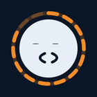

# Expressions

← [Back to README](../README.md)

Alison has a face. It is drawn live in the panel header (and, smaller, in the bar), in the colours of the
active Omarchy theme, and it always tells the truth about what she is doing: the microphone ring only
shows when she is really listening, her mouth follows the **real volume** of her voice.

## Alive

<table>
  <tr>
    <td align="center"> <b>Idle</b> breathes, blinks, smiles</td>
    <td align="center"> <b>Listening</b> a crown of bars follows your voice</td>
    <td align="center"> <b>Speaking</b> her mouth follows her real voice</td>
  </tr>
  <tr>
    <td align="center"> <b>Thinking</b> a spinning arc, eyes looking up</td>
    <td align="center"> <b>Waiting for you</b> eyebrows raised, the ring pulses until you answer the card</td>
    <td align="center"> <b>Not for her</b> a little shake of the head</td>
  </tr>
</table>

## Moods

| | Mood | When |
|:-:|---|---|
|  | **Idle** | at rest |
|  | **Listening** | the microphone is open; the bars follow your voice |
|  | **Thinking** | transcribing or waiting for the agent |
|  | **Speaking** | reading her answer aloud |
|  | **Waiting** | an approval card is open |
|  | **Focused** | an approved action is running |
|  | **Not for her** | she heard a sentence that was not addressed to her |
|  | **Microphone off** | hands-free conversation, microphone cut: eyes half closed, dotted ring |
|  | **Worried** | something failed; the ring takes the theme's urgent colour |

## What she is doing

While the agent works, her face shows *what* it is doing, derived from the tools it uses:

| | Activity | Tool |
|:-:|---|---|
|  | **Searching** — eyes scanning, a dot runs on the ring | web search |
|  | **Reading** — lines of text scroll by | reading a page or a file |
|  | **Writing** — a blinking cursor, the ring fills | editing a text |
|  | **Coding** — braces, the ring fills | editing code |
|  | **Running** — the `>` prompt and its cursor | running a command |
|  | **Mail** — an envelope | reading mail |
|  | **Dreaming** — eyes closed, rising “z” | tidying her memory while the machine is idle |

Everything is drawn with one `Canvas` (`Avatar.qml`) from the theme's colours, so every Omarchy theme —
light, dark, square or round — gives her its own look. The animation clock only runs while she is visible.
